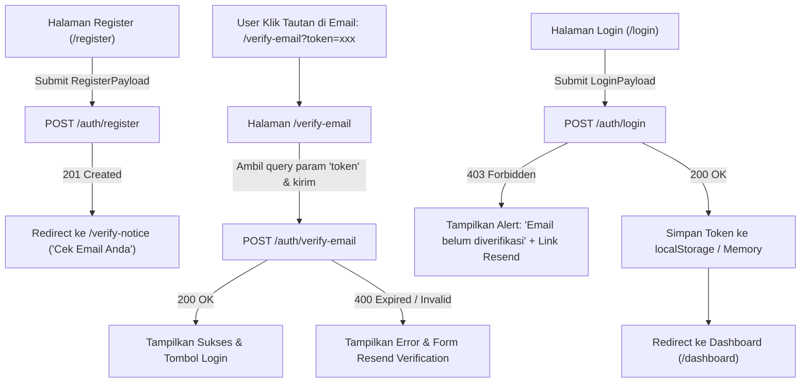

# Dokumentasi API Autentikasi & Panduan Integrasi Frontend (Momentum)

Dokumen ini dirancang khusus untuk Frontend Developer agar mempermudah implementasi antarmuka pengguna (UI), *state management* (TanStack Query / Context), serta penanganan alur verifikasi email di **momentum-fe**.

---

## 1. Konfigurasi Dasar

- **Base URL:** `http://localhost:8080/api/v1`
- **Default Headers:**
  ```http
  Content-Type: application/json
  Accept: application/json
  ```
- **Protected Request Header:**
  ```http
  Authorization: Bearer <jwt_token>
  ```

---

## 2. TypeScript Interfaces (Siap Pakai di Frontend)

Salin interface ini ke file types frontend Anda (contoh: `src/types/auth.ts`):

```typescript
// Standard API Envelope Response
export interface ApiResponse<T = null> {
  message: string;
  data?: T;
}

export interface ApiErrorResponse {
  error: string;
}

// User & Entity
export interface User {
  id: string;
  email: string;
  name: string;
  email_verified_at?: string | null;
  created_at: string;
}

// Request Payloads
export interface RegisterPayload {
  name: string;
  email: string;
  password: string;
}

export interface LoginPayload {
  email: string;
  password: string;
}

export interface VerifyEmailPayload {
  token: string;
}

export interface ResendVerificationPayload {
  email: string;
}

export interface UpdateProfilePayload {
  name: string;
}

// Auth Responses
export interface RegisterResponseData {
  user: User;
}

export interface LoginResponseData {
  token: string;
  user: User;
}

export interface SessionStatusData {
  active: boolean;
}
```

---

## 3. Alur End-to-End di Frontend (React Flow)



---

## 4. Rincian Endpoint

### 4.1. Registrasi Akun Baru
Mendaftarkan akun baru. Akun dibuat dengan status **belum terverifikasi** dan **tidak** menghasilkan token JWT login.

- **Method:** `POST`
- **Endpoint:** `/auth/register`
- **Request Body:**
  ```json
  {
    "name": "Dewi Ayu",
    "email": "user@example.com",
    "password": "Password123!"
  }
  ```
  *Aturan Validasi:*
  - `email`: Format email standar.
  - `password`: Minimal 8 karakter, wajib kombinasi huruf, angka, dan simbol.
- **Response Success (`201 Created`):**
  ```json
  {
    "message": "Registrasi berhasil. Silakan cek email Anda untuk memverifikasi akun sebelum login.",
    "data": {
      "user": {
        "id": "c1f7a18b-...",
        "email": "user@example.com",
        "name": "Dewi Ayu",
        "created_at": "2026-10-17T17:18:00Z"
      }
    }
  }
  ```
- **Response Error:**
  - `400 Bad Request`: Format email tidak valid / Password lemah.
  - `409 Conflict`: Email sudah terdaftar.

---

### 4.2. Login
Melakukan login. Hanya akun yang sudah memverifikasi email yang diizinkan masuk.

- **Method:** `POST`
- **Endpoint:** `/auth/login`
- **Request Body:**
  ```json
  {
    "email": "user@example.com",
    "password": "Password123!"
  }
  ```
- **Response Success (`200 OK`):**
  ```json
  {
    "message": "Login berhasil",
    "data": {
      "token": "eyJhbGciOiJIUzI1NiIsInR5cCI6IkpXVCJ9...",
      "user": {
        "id": "c1f7a18b-...",
        "email": "user@example.com",
        "name": "Dewi Ayu",
        "email_verified_at": "2026-10-17T17:20:00Z",
        "created_at": "2026-10-17T17:18:00Z"
      }
    }
  }
  ```
- **Response Error:**
  - `401 Unauthorized`: Email atau password salah.
  - `403 Forbidden`: Email belum diverifikasi. Tampilkan pesan dan arahkan ke opsi kirim ulang verifikasi.

---

### 4.3. Verifikasi Email
Memvalidasi token yang diklik pengguna dari tautan email.

- **Method:** `POST`
- **Endpoint:** `/auth/verify-email`
- **Request Body:**
  ```json
  {
    "token": "3a7b9c1d2e..."
  }
  ```
- **Response Success (`200 OK`):**
  ```json
  {
    "message": "Email berhasil diverifikasi. Silakan login ke akun Anda."
  }
  ```
- **Response Error (`400 Bad Request`):**
  - `"Token verifikasi tidak valid."` (token palsu atau salah ketik).
  - `"Token verifikasi sudah pernah digunakan."` (mencegah *replay attack*).
  - `"Token verifikasi sudah kedaluwarsa. Silakan minta kirim ulang tautan verifikasi."` (lewat dari 30 menit).

---

### 4.4. Kirim Ulang Tautan Verifikasi (*Resend Verification*)
Mengirimkan tautan verifikasi baru jika token lama kedaluwarsa atau hilang.

- **Method:** `POST`
- **Endpoint:** `/auth/resend-verification`
- **Request Body:**
  ```json
  {
    "email": "user@example.com"
  }
  ```
- **Response Success (`200 OK`):**
  ```json
  {
    "message": "Tautan verifikasi baru berhasil dikirim ke email Anda."
  }
  ```
  *(Catatan Keamanan: Jika email tidak terdaftar, backend tetap merespons 200 OK dengan pesan netral untuk mencegah User Enumeration Attack).*
- **Response Error:**
  - `400 Bad Request`: Email sudah terverifikasi sebelumnya.

---

### 4.5. Status Sesi Aktif
Memeriksa apakah token JWT pengguna masih aktif dan valid secara cepat.

- **Method:** `GET`
- **Endpoint:** `/auth/session`
- **Headers:** `Authorization: Bearer <token>` (Opsional)
- **Response (`200 OK`):**
  ```json
  {
    "message": "Status sesi",
    "data": {
      "active": true
    }
  }
  ```

---

### 4.6. Ambil Profil Pengguna (Protected)
Mengambil detail profil akun yang sedang login.

- **Method:** `GET`
- **Endpoint:** `/profile/me`
- **Headers:** `Authorization: Bearer <token>` (Wajib)
- **Response Success (`200 OK`):**
  ```json
  {
    "message": "Profil berhasil dimuat",
    "data": {
      "id": "c1f7a18b-...",
      "email": "user@example.com",
      "name": "Dewi Ayu",
      "created_at": "2026-10-17T17:18:00Z"
    }
  }
  ```
- **Response Error (`401 Unauthorized`):** Token tidak ada, format salah, atau sudah expired.

---

### 4.7. Update Profil (Protected)
Mengubah nama profil pengguna yang sedang login.

- **Method:** `PATCH`
- **Endpoint:** `/profile/me`
- **Headers:** `Authorization: Bearer <token>` (Wajib)
- **Request Body:**
  ```json
  {
    "name": "Dewi Ayu Safitri"
  }
  ```
- **Response Success (`200 OK`):**
  ```json
  {
    "message": "Profil berhasil diperbarui",
    "data": {
      "id": "c1f7a18b-...",
      "email": "user@example.com",
      "name": "Dewi Ayu Safitri",
      "created_at": "2026-10-17T17:18:00Z"
    }
  }
  ```

---

## 5. Tips Implementasi di React & TanStack Query

### A. HTTP Client Interceptor (Axios / Fetch Wrapper)
Otomatis pasang token ke header setiap kali request ke backend:

```typescript
// Contoh dengan Axios interceptor:
api.interceptors.request.use((config) => {
  const token = localStorage.getItem("token");
  if (token) {
    config.headers.Authorization = `Bearer ${token}`;
  }
  return config;
});

// Tangani 401 Unauthorized secara global:
api.interceptors.response.use(
  (response) => response,
  (error) => {
    if (error.response?.status === 401) {
      localStorage.removeItem("token");
      window.location.href = "/login";
    }
    return Promise.reject(error);
  }
);
```

### B. Halaman Verifikasi Email di React Router
Di React Router, buat rute `/verify-email`:

```tsx
import { useEffect } from "react";
import { useSearchParams, useNavigate } from "react-router-dom";
import { useMutation } from "@tanstack/react-query";

export function VerifyEmailPage() {
  const [searchParams] = useSearchParams();
  const token = searchParams.get("token");
  const navigate = useNavigate();

  const verifyMutation = useMutation({
    mutationFn: (token: string) => authApi.verifyEmail({ token }),
    onSuccess: () => {
      // Tampilkan toast sukses, redirect ke /login setelah 2 detik
      setTimeout(() => navigate("/login"), 2000);
    },
  });

  useEffect(() => {
    if (token) {
      verifyMutation.mutate(token);
    }
  }, [token]);

  if (!token) return <p>Token verifikasi tidak ditemukan di URL.</p>;
  if (verifyMutation.isPending) return <p>Sedang memverifikasi akun Anda...</p>;
  if (verifyMutation.isError) {
    return (
      <div>
        <p>Gagal verifikasi: {verifyMutation.error.message}</p>
        <button onClick={() => navigate("/resend-verification")}>
          Kirim Ulang Tautan Verifikasi
        </button>
      </div>
    );
  }

  return <p>Email berhasil diverifikasi! Mengalihkan ke halaman login...</p>;
}
```

